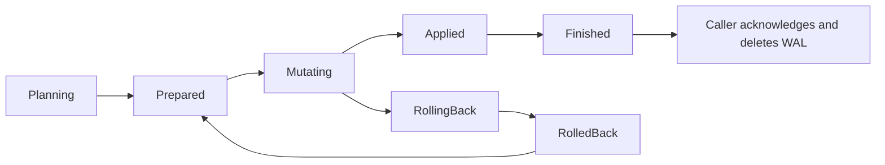

# Conflict recovery

BlockAssembly records one WAL intent for each forward conflict-resolution operation.
The intent identifies the block and the winning transactions. Its recovery checklist
stores the affected transactions, their original `Conflicting` flags, the original
spend owners, the winning spends, and the parents to unlock.

The operation owns this record. It has no process ID and no process lease. A new
process can recover it after a restart. This design assumes that BlockAssembly
serializes reorg operations. It does not support concurrent reorg writers.

## Recovery phases

- `planning`: the intent exists, but no state changes have started.
- `prepared`: the complete before-image is saved. Parent locks can be acquired.
- `mutating`: changes can be partial. Recovery first restores the before-image.
- `rolling_back`: compensation is in progress. Recovery repeats compensation.
- `rolled_back`: original spend owners and flags have been restored.
- `applied`: winning spends and flags have been written. Unlocking can be pending.
- `finished`: UTXO work has finished. Subtree and queue updates can be pending.

A forward retry uses the saved descendant list. It does not try to recover deleted
spend links from the current UTXO graph. Rollback restores the recorded spend
owners, checks them, and then restores the original flags. An unexpected spender
causes an error; recovery does not overwrite it. This case retains the WAL for
diagnosis and repair.

A child can attach to a checklist transaction after the checklist was saved. The
rollback does not touch the inputs of that child, so it needs no before-image. When
the child's parent ends `Conflicting`, the rollback marks the child and its
descendants `Conflicting` too, and reports them for txmeta cache eviction.

BlockAssembly retains a finished WAL until subtree updates and the queue drain
succeed. At startup, it replays pending work before loading unmined transactions.
Unresolved recovery prevents startup, and so does a record whose replay failed,
even when its checklist reads finished. Finished forward records are removed only
after the startup subtree updates and queue drain succeed, and only when block
assembly has reached the record's block. Otherwise the catch-up applies the block,
accepts the applied winners from the finished checklist and acknowledges the record.

A successful reverse retires the finished forward record of its block, so a later
re-add of the block runs a new forward operation. At startup, replay runs reverse
records first. A forward record whose block still has a pending reverse record is
left as it is, because a rollback over a partial reverse could corrupt the store.

## Store implementations

SQL stores add nullable `recovery` and `conflict_owner` columns. The existing
conditional spend writer performs each recovery write synchronously. Parent locks
carry the operation ID. Ordinary lock writes clear that ID, so recovery cannot
release a lock that another operation has acquired. A parent that another holder
already locked is left out of the operation's lock set. The operation neither takes
nor releases that lock. Taking the lock set is all or nothing. A rollback before any
mutation releases only the locks that the operation still owns, because another
holder can lock a parent between preparation and acquisition.

Aerospike stores save the checklist in 64 KiB chunks in the WAL data set. A checksum
identifies the complete checklist. The root record publishes its phase and chunk
reference after the chunks are written. The checklist content does not change after
publication, so a later phase change writes only the root phase. Cleanup retains the
root until all chunks are deleted. These records do not expire automatically.
Restored spends are written in synchronous Lua batches, so no write arrives after
the rollback returns.

Aerospike conflict recovery does not acquire or release parent locks. This matches
its existing `Unspend` behavior. Boolean validation locks must not be cleared by
recovery.

External `utxo.Store` implementations must implement the five recovery methods in
`stores/utxo/Interface.go`. They must preserve conditional spend writes and durable
phase ordering. Returning success without saving the checklist is not sufficient.

## Upgrade and repair

Upgrade BlockAssembly and its store implementation together. Do not downgrade
while new-format intents remain pending.

A legacy forward WAL has no before-image. It cannot prove which transaction owned
an input or which operation acquired a lock. Recovery retains such a record and
reports that manual repair is required. Do not delete it to bypass the check.

If recovery fails:

1. Preserve the WAL, UTXO store backup, block hash, intent ID, and error log.
2. Correct storage or connectivity faults and retry startup.
3. For a legacy record or ownership mismatch, inspect the chain and original store
   state before repair. This change does not provide an automatic legacy repair
   command.

See PR 2023 for the implementation and regression tests.

## Current-chain protection

A transaction can be in both an orphaned block and a later main-chain block.
Before rollback or reverse processing marks a transaction conflicting or removes
its spend, BlockAssembly checks all of its mined block IDs against the current
chain. The same check protects descendants reached during reverse processing.
If a transaction is confirmed, or the chain lookup fails, recovery stops and
retains the WAL. The saved before-image does not override current confirmation.

The winners of a forward operation are mined in the block being added. That block is
already on the current chain. The forward rollback therefore ignores that one block
ID for the winners. It still refuses a winner that is confirmed in any other
current-chain block, and it still refuses every other transaction.

A stale forward record can have winners that the new chain confirms again. When
every winner is confirmed on the current chain, still owns its inputs and is not
`Conflicting`, the current chain confirms the same outcome. Startup then completes
the record without a rollback. When only some winners are confirmed, the rollback
still refuses and the record stays pending for repair.

The loser set that a forward operation returns, and the list of marked transactions,
never contain a winner.

Failed WAL completion writes return an error and increment
`teranode_utxo_conflict_wal_completion_failures_total`. BlockAssembly logs replay
cleanup failures. These failures must not be treated as successful recovery.

These checks prevent further damage. They do not repair a store corrupted by an
older build. Invalidating a block alone does not establish that its node's UTXO
state matches the other nodes.
