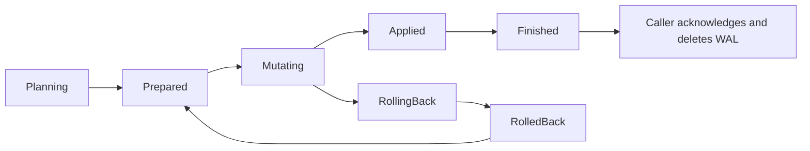

# Conflict recovery

BlockAssembly records one WAL intent for each forward conflict-resolution operation.
The intent identifies the block and the winning transactions. Its recovery checklist
stores the affected transactions, their original `Conflicting` flags, the original
spend owners, the winning spends, and the parents to unlock.

The operation owns this record. It has no process ID and no process lease. A new
process can recover it after a restart. This design assumes that BlockAssembly
serializes reorg operations. It does not support concurrent reorg writers.

A forward intent is keyed by its block hash. Every caller and every retry of the
block finds the same record, whatever subset of the winners it passes. The record
keeps one invariant at every durable step: its checklist holds the before-image of
every winner it applied, and it names every loser that the caller has not yet
acknowledged. A caller that passes an additional winner that is still Conflicting
receives an error before any state change. An additional winner that is already
applied (not Conflicting, and the spender of every input) is dropped, because
`reorgBlocks` can record a subset of a block's winners and a later reset or catch-up
passes the full list. An additional winner that is not Conflicting but lost an input
is an error. To add a Conflicting winner, the
caller must first recover the saved result using the recorded winners (or a subset),
finish its subtree and queue updates, and acknowledge the existing intent with
`CompleteConflictIntentsForBlock`. Only then may it submit additional winners as a
new operation. Do not delete an unfinished record to bypass this check. Superset
replanning is not supported: rolling back an applied winner just to add another
winner can incorrectly demote a child accepted since the original snapshot.

New planning records also save their requested winners, so the same admission rule
applies if discovery or snapshotting fails. Older planning records without winners
can still be planned because they hold no before-image and have changed no state.
A retry after failure or partial reverse retains the original winner set and rolls
the earlier checklist back before taking a new before-image. Its still-conflicting
losers carry into the new result until acknowledged. The record is never deleted
between rollback and saving the replacement checklist. The
acknowledgement and the retirement of a block compute the ID, so they do not scan
the WAL. A reverse intent is keyed by its block
and its transactions. A record that an older build wrote keeps the key of that
build; the WAL scan reports it under that key, and it still needs manual repair.

## Recovery phases

- `planning`: the intent exists, but no state changes have started.
- `prepared`: the complete before-image is saved. Parent locks can be acquired.
- `mutating`: changes can be partial. Recovery first restores the before-image.
- `rolling_back`: compensation is in progress. Recovery repeats compensation.
- `rolled_back`: original spend owners and flags have been restored.
- `applied`: winning spends and flags have been written. Unlocking can be pending.
- `finished`: UTXO work has finished. Subtree and queue updates can be pending.

A forward retry uses the saved descendant list. It does not try to recover deleted
spend links from the current UTXO graph. Rollback restores the recorded spend
owners, checks them, and then restores the original flags. An unexpected spender
causes an error; recovery does not overwrite it. This case retains the WAL for
diagnosis and repair.

There is one exception. The operation frees the inputs of its losers, and the
rollback frees the winning inputs that were unspent at planning. The validator can
give such a freed input to a new transaction before the rollback verifies it. That
spend is legitimate. When the new owner is outside the checklist and not
`Conflicting`, the rollback leaves the input with that owner. A loser that lost an
input this way ends `Conflicting` and gets none of its inputs back. So does every
checklist transaction that spends that loser's outputs.

A child can attach to a checklist transaction after the checklist was saved. The
rollback does not touch the inputs of that child, so it needs no before-image. When
the child's parent ends `Conflicting`, the rollback marks the child and its
descendants `Conflicting` too, and reports them for txmeta cache eviction. The
rollback finds such a child from the spenders of the winners' outputs, so a retry
after a failed rollback still finds it when the winner is already `Conflicting`.

A validator can also spend a free winning input after discovery and before the
snapshot. The checklist then records an owner that is not in the discovered set.
The forward operation stops before it changes anything and asks for a retry. The
retry discovers that spender and marks it `Conflicting`.

An input of a conflicting cascade member can belong to a transaction outside the
cascade. That spend is not part of the operation. The checklist leaves it out, so the
operation neither unspends nor restores it, and the owner keeps its input.

BlockAssembly retains a finished WAL until subtree updates and the queue drain
succeed. At startup, it replays pending work before loading unmined transactions.
Unresolved recovery prevents startup, and so does a record whose replay failed,
even when its checklist reads finished. Finished forward records are removed only
after the startup subtree updates and queue drain succeed, and only when block
assembly has reached the record's block. Otherwise the catch-up applies the block,
accepts the applied winners from the finished checklist and acknowledges the record.

After a successful reverse, its caller retires the applied or finished forward
record of the block and releases any parent lock that the record still owns. A reorg
does this for all its moved-back blocks. The reverse has already committed, so a
failed retirement is only logged. A reset does not reverse the blocks that it moves
back, so their effects stay in the store. It retires their forward records in the
same way, so the next startup does not roll back an operation that has stayed live.

A reverse can stop part way: it reversed some winners, or marked a winner
`Conflicting` before it gave the winner's inputs back. A later re-add of the block,
or the replay at startup, finds a winner that is `Conflicting` again. It rolls the
record back, which restores the winners the reverse did not reach, and plans again
under the same record with a new before-image of every winner. The rollback accepts
a winner confirmed in the record's own block. When no forward record is left, the
new plan skips each winner that is not `Conflicting` and owns every input, because
that winner is applied and acknowledged. At startup,
replay runs reverse records first. A forward record whose block still has a pending
reverse record is left as it is, because a rollback over a partial reverse could
corrupt the store.

A failed acknowledgement after a block is committed is only logged. The finished
record stays pending, and the next startup replays and acknowledges it.

## Store implementations

SQL stores add nullable `recovery` and `conflict_owner` columns. The existing
conditional spend writer performs each recovery write synchronously. Parent locks
carry the operation ID. Ordinary lock writes clear that ID, so recovery cannot
release a lock that another operation has acquired. A parent that another holder
already locked is left out of the operation's lock set. The operation neither takes
nor releases that lock. Taking the lock set is all or nothing. A rollback before any
mutation releases only the locks that the operation still owns, because another
holder can lock a parent between preparation and acquisition.

Aerospike stores save the checklist in 64 KiB chunks in the WAL data set. A checksum
identifies the complete checklist. The root record publishes its phase and chunk
reference after the chunks are written. The checklist content does not change after
publication, so a later phase change writes only the root phase. Cleanup retains the
root until all chunks are deleted. These records do not expire automatically.
Restored spends are written in synchronous Lua batches. Each batch uses the remaining
compensation deadline as its client timeout; recovery waits for dispatch to finish
before returning. SQL restore statements and deadlock backoff use that same
compensation context.

Aerospike conflict recovery does not acquire or release parent locks. This matches
its existing `Unspend` behavior. Boolean validation locks must not be cleared by
recovery.

External `utxo.Store` implementations must implement the five recovery methods in
`stores/utxo/Interface.go`. They must preserve conditional spend writes and durable
phase ordering. Returning success without saving the checklist is not sufficient.

## Upgrade and repair

Upgrade BlockAssembly and its store implementation together. Do not downgrade
while new-format intents remain pending.

A legacy forward WAL has no before-image. It cannot prove which transaction owned
an input or which operation acquired a lock. Recovery retains such a record and
reports that manual repair is required. Do not delete it to bypass the check.

If recovery fails:

1. Preserve the WAL, UTXO store backup, block hash, intent ID, and error log.
2. Correct storage or connectivity faults and retry startup.
3. For a legacy record or ownership mismatch, inspect the chain and original store
   state before repair. This change does not provide an automatic legacy repair
   command.

See PR 2023 for the implementation and regression tests.

## Current-chain protection

A transaction can be in both an orphaned block and a later main-chain block.
Before rollback or reverse processing marks a transaction conflicting or removes
its spend, BlockAssembly checks all of its mined block IDs against the current
chain. The same check protects descendants reached during reverse processing.
If a transaction is confirmed, or the chain lookup fails, the rollback or reverse
stops and recovery retains the WAL. The saved before-image does not override current
confirmation. A stale forward record with a confirmed winner does not reach the
rollback: startup keeps its applied state, as described below.

The winners of a forward operation are mined in the block being added. That block is
already on the current chain. The forward rollback therefore ignores that one block
ID for the winners. It still refuses a winner that is confirmed in any other
current-chain block, and it still refuses every other transaction.

A stale forward record whose winners a reverse undid is retired. A winner counts as
reversed when it is `Conflicting` again and no longer owns every input. A parent
that the pruner removed, after the restored loser was confirmed, counts as a lost
input; a storage failure keeps the record.

A stale forward record can have winners that the new chain confirms again. When the
operation was applied and at least one winner is confirmed on the current chain,
startup keeps the applied state of the confirmed winners, as a reorg keeps a
transaction of an orphaned block. Each confirmed winner must still own every input whose parent remains in the store.
The same allowance applies when replaying a finished intent whose block remains
on the current chain. A missing parent may have been pruned during the outage; current-chain confirmation
is sufficient for that input. Storage failures still retain the checklist.
If one does not, the store contradicts the record, and the record stays pending.
This includes a partial re-mine, where the new chain confirms only some winners.
For the other winners:

- When block assembly reached the stale block, its catch-up moves the block back,
  and that reverse handles them.
- When block assembly never reached the block, no moveBack follows. Startup
  reverses them itself. The reverse records its own intent, and the forward record
  stays until the reverse succeeds.

Then startup releases the parent locks that the record still owns and completes the
record without a rollback. A stale forward record whose winners a reverse has
already undone is retired in the same way. Otherwise the record is rolled back.

The loser set that a forward operation returns, and the list of marked transactions,
never contain a winner.

Failed WAL completion writes return an error and increment
`teranode_utxo_conflict_wal_completion_failures_total`. BlockAssembly logs replay
cleanup failures. These failures must not be treated as successful recovery.

These checks prevent further damage. They do not repair a store corrupted by an
older build. Invalidating a block alone does not establish that its node's UTXO
state matches the other nodes.

## Remaining concurrency and descendant behavior

A reverse marks a winner's mempool descendants Conflicting. Re-adding the block
restores the winner, but does not automatically clear those descendants: they must
be resubmitted and validated before becoming eligible for mining again.

SQL recovery leaves a foreign parent lock with its owner. That owner can release
it during the operation, allowing a new spend to race recovery. Aerospike recovery
also has no parent locks. Conditional ownership checks retain the checklist on an
unexpected contested-input owner; recovery never overwrites that owner's spend.
